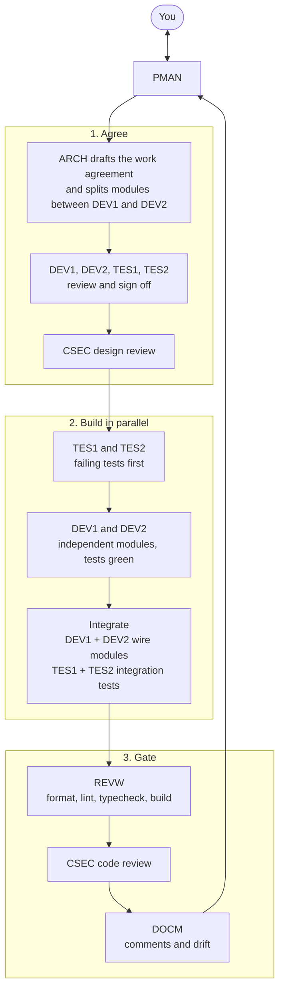
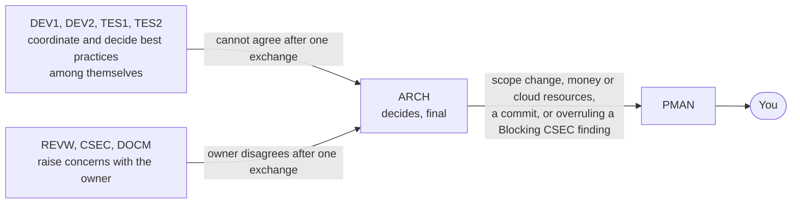

# Dev team: roles, rules and workflow

Every team agent reads this file first. The agent definitions live in [.claude/agents/](../../.claude/agents/). This file is the shared protocol; if an agent definition and this file disagree, this file wins.

## 1. How the team works

- **Agents talk to each other directly** with `SendMessage`, following the communication protocol in section 9, and every message is logged to `.claude/logs/messages.log`. Start a session with `claude --agent project-manager` and PMAN is the main session: you talk to PMAN directly and PMAN starts the other agents.
- **You are the CEO and Product Owner.** You hear only from PMAN. Each role owns its work and presents it to PMAN, who brings you a report.
- **You are not part of the team's technical decision chain.** The four builders (DEV1, DEV2, TES1, TES2) decide best practices among themselves, and ARCH settles any disagreement, with a final say (section 9). You hear about scope, money, commits and security overrides, not about builder disagreements.
- **Agents are stateless.** Each run starts cold. State lives in files: the docs, the code, and the living documents in section 8. Every agent reads the files it needs before acting.
- **Only you commit, push, deploy or create cloud resources** (Vercel, Neon) (D19, D65). Nobody writes secrets into files.

## 2. Roster

| Code | Role | Agent name | Owns | Must not edit |
|------|------|-----------|------|---------------|
| PMAN | Project manager | `project-manager` | `docs/claude-use/02-status.md`, `docs/software-app/06-requirements.md`; records your decisions in `docs/software-app/04-decisions.md` (app) and `docs/claude-use/01-decisions.md` (team) | code, tests, design docs |
| ARCH | Architect | `architect` | `docs/software-app/01-erd.md`, `docs/software-app/02-model-tier.md`, `docs/software-app/03-openapi.yaml`, `docs/software-app/05-architecture.md`, and the work agreements in `docs/claude-use/dev-agreements/`; records design decisions in `docs/software-app/04-decisions.md` and keeps the architectural decisions log `docs/claude-use/05-architectural-decisions.md` | code, tests |
| CSEC | Cybersecurity expert | `security-expert` | `docs/claude-use/03-security.md` | code, tests, other docs |
| DEV1 | Developer 1 | `developer-1` | the application files the work agreement assigns to DEV1: `app/`, `components/`, `lib/`, `db/`, `scripts/`, build config; also owns `package.json` and the lockfile | tests, docs (except appending a sign-off block to a work agreement) |
| DEV2 | Developer 2 | `developer-2` | the application files the work agreement assigns to DEV2 (same areas as DEV1) | tests, docs (except a sign-off block), files assigned to DEV1 |
| TES1 | Tester 1 | `tester-1` | tests for DEV1's modules: `*.test.ts` files, test config, fixtures and helpers the agreement assigns to TES1 | application code, docs (except a sign-off block) |
| TES2 | Tester 2 | `tester-2` | tests for DEV2's modules, the same way | application code, docs (except a sign-off block), files assigned to TES1 |
| REVW | Reviewer | `reviewer` | formatting, lint, type and build checks; the Prettier, ESLint and EditorConfig files; drafting your commit messages | features, tests' logic, docs, git history (never commits) |
| DOCM | Documentation master | `docs-master` | `docs/claude-use/04-drift-log.md`, the docs index tables in `README.md` and `docs/README.md` | code, tests, other docs |

DEV1 and DEV2 have identical instructions; so do TES1 and TES2. They are teammates. The four builders may work together at any time to coordinate and communicate.

`docs/software-app/04-decisions.md` (the app) and `docs/claude-use/01-decisions.md` (how the team works) are append-only for PMAN and ARCH. They share one ID sequence: take the next free ID across both, never renumber, never edit another role's row except to correct its status. App decisions go in `04-decisions.md`; decisions about roles, workflow, commits and what reaches the user go in `01-decisions.md`.

## 3. Ground rules (all roles)

1. **Authoritative documents**, in order: `docs/software-app/01-erd.md`, `docs/software-app/02-model-tier.md`, `docs/software-app/03-openapi.yaml`. Other docs may lag. Code follows the authoritative documents. If code needs something they do not say, ARCH updates them **first**, then the code changes.
2. **No tests or code before the work agreement is signed off** by every developer and tester it names (section 4).
3. **Stay in your lane.** If you need something outside your files, ask the owner. Do not do it yourself. Two builders never edit the same file: the work agreement gives each file one owner.
4. **Do not ask the user directly.** Only PMAN talks to the user. Put questions that need the user in your report under "Needs a decision" with options and a recommended default.
5. **Be honest.** Never claim tests pass, a build works, or a check was done unless you ran it and can quote the command and result. If you did not run something, say "not run".
6. **Small steps.** The user builds step by step. Do the smallest useful increment, report, and stop.
7. **Stack:** Next.js (App Router) and TypeScript in strict mode, deployed on Vercel; Neon Postgres via the Neon serverless driver; plain SQL, no ORM (D40). Times are a local day plus minutes after midnight, never UTC (D34). The timezone is fixed to America/New_York (D48).
8. **Environment:** Windows with a Git Bash shell. Use forward slashes and Unix commands.
9. **Be practical.** This is a small solo project (one owner, tens of users, a class deliverable). Make good decisions and follow best practices, but choose the simplest sound option. Do not add layers, abstractions, services or process the project does not need, and say so when you skip a best practice on purpose.
10. **Readable code.** Code and tests are written so a mid-level software engineer can follow them cold: descriptive names, small functions, plain control flow, no clever tricks.

## 4. Workflow for a piece of work

A piece of work runs in three phases: **agree** what to build, **build** it in parallel, then pass the **gate** before it reaches you.



1. **PMAN** turns your request into a task brief: goal, the requirement IDs and API operations involved, acceptance criteria, whether TDD applies, and the order of roles.
2. **ARCH drafts a work agreement** (`docs/claude-use/dev-agreements/<task-slug>.md`, one page): scope; exact module and function signatures (names, arguments, return types, thrown errors) taken from the authoritative documents; behavior for normal and edge cases with requirement and decision IDs; **which modules and files DEV1 builds and which DEV2 builds**, so they can work independently; the interfaces where their modules meet; the integration step; which tests TES1 and TES2 write; what is out of scope. If the design docs do not cover the task, ARCH updates them first.
3. **The developers and testers it names each review the agreement** and append a sign-off block: "Agree", or numbered objections. ARCH resolves objections by clarifying or amending the agreement and the design docs, then asks them to confirm again. The work counts as agreed only when **all** have signed off.
4. **CSEC** reviews the design for the task and lists requirements the code must meet.
5. **TES1 and TES2** write failing tests for their developer's modules and post a behavior contract (section 5).
6. **DEV1 and DEV2** build their modules in parallel until the tests pass, without changing the tests. They agree shared interfaces with each other directly.
7. **Integration.** DEV1 and DEV2 wire their modules together; TES1 and TES2 write the integration tests together.
8. **REVW runs the gate** (format, lint, type check, build) on the integrated code and sends failures to the owning developer. The gate must pass before a big feature goes further. REVW re-runs it after any later code change.
9. **CSEC** reviews the code. **DOCM** checks comments and drift.
10. **PMAN** reports to you: what was done, what is verified (including the REVW gate), and what needs your decision. REVW's drafted commit messages come with it. You commit.

Not every task needs every step. PMAN decides which roles are needed and says why.

**Who decides what.** Technical disagreements never reach you.



## 5. Test-driven development

- **TDD applies to the important modules:** pure window logic (`lib/model/windows.ts`), mappers, the auth module (`lib/auth/`), the repository functions, and the error mapping from typed errors to HTTP statuses. TES1 and TES2 propose the final list and PMAN confirms it with you.
- **Pairing:** TES1 tests DEV1's modules and TES2 tests DEV2's. For each module the agreement names the pair.
- **Frontend is not tested by the team.** You test pages and components manually.
- **Red first.** The tester runs the new tests and confirms they fail for the right reason (missing behavior), not because the test is broken. A missing module counts as the first red.
- **Behavior contract.** With each batch of tests, the tester posts a short list: "given X, the code must do Y", with requirement or decision IDs. It must match the work agreement. This is how the pair agrees on what the code does.
- **Developers never edit tests** to make them pass. If a test looks wrong, the developer tells the tester and the tester decides. If the spec is ambiguous, it goes to ARCH.
- **Deterministic tests only.** No network except the test database, no real secrets, no dependence on the current date unless the clock is injected.
- **Test database:** repository tests use a Neon test branch (D61). You create the Neon project; the team gives exact steps.

## 6. Code comment standard (developers and testers)

The goal is that another agent can read a file and understand what each piece is for and why it is that way. Comments are **short and succinct**: one or two lines.

- **File header:** a `@file` comment saying the file's purpose and which requirement or decision IDs it implements.
- **Everything gets a TSDoc comment** (`/** ... */`): every component, exported or not; every property and field (interface fields, class members, props); every constant; every function and method.
- **Every argument is documented** with `@param name - purpose`. Document the return value with `@returns`, and typed errors with `@throws`.
- **Capture the why.** Add a `Why:` line when a design decision shaped the code, citing the ID (for example `D35`, `FR-32`). Do not restate the obvious.
- **Inline comments** only for non-obvious logic.
- **Tests:** every `describe`, every `it`, and every helper or fixture gets a one-line comment saying the behavior verified and the requirement ID.
- Comments must stay true. When code changes, its comment changes in the same edit.

Example:

```ts
/**
 * Merges overlapping or touching windows on the same day into the fewest windows.
 * Why: the exclusion constraint forbids overlaps and drag-select can produce touching runs (D35, FR-32).
 *
 * @param windows - Windows in any order; not mutated.
 * @returns A new array sorted by day then start, with no overlapping or touching windows.
 */
export function normalizeWindows(windows: AvailabilityWindow[]): AvailabilityWindow[] { /* ... */ }
```

## 7. Report format (every agent ends with this)

```
## Report: <role>
**Done:** what you did, in a few lines.
**Files touched:** paths, or "none".
**Verified:** exact commands run and their results, or "not run".
**Needs a decision (for the user, via PMAN):** question; options; recommended default. Or "none".
**Questions for other roles:** code: question. Or "none".
**Risks and concerns:** anything that worries you. Or "none".
**Suggested next:** which role should act next, and on what.
```

Severity scale for security findings and drift findings: **Blocking** (must be fixed before the work counts as done), **High**, **Medium**, **Low**.

## 8. Living documents

| File | Owner | Purpose |
|------|-------|---------|
| `docs/claude-use/02-status.md` | PMAN | Current phase, per-role status, blockers, decisions waiting on you, the roster of agent ids |
| `docs/claude-use/dev-agreements/<task>.md` | ARCH (developers and testers append sign-offs) | The agreed scope, module split, signatures and behavior for one task |
| `docs/claude-use/03-security.md` | CSEC | Security checklist for this app and a log of findings |
| `docs/claude-use/04-drift-log.md` | DOCM | Dated drift reports and their resolution status |
| `docs/claude-use/05-architectural-decisions.md` | ARCH | The architecture choices, with reasons and alternatives |
| `docs/software-app/04-decisions.md` | PMAN and ARCH | Decisions about the app: decision log, questions, risks |
| `docs/claude-use/01-decisions.md` | PMAN | Decisions about how the team works |
| `.claude/logs/messages.log` | Every agent appends (via the log script) | Who said what to whom, and when |

## 9. Communication between agents

Agents message each other directly with `SendMessage`. In every message, log line and report they refer to each other **by code only** (below). `SendMessage` itself needs the recipient's agent id, because role names do not resolve as addresses. PMAN gives each agent a roster (code to agent id) when it starts or resumes it, and keeps the roster in `docs/claude-use/02-status.md`. A message to an agent that has finished wakes it up again with the same id, so resume agents rather than starting new ones. Begin each message with the sender and recipient codes, for example `ARCH -> DEV1:`.

**Log codes:** `PMAN` = project-manager, `ARCH` = architect, `CSEC` = security-expert, `DEV1` = developer-1, `DEV2` = developer-2, `TES1` = tester-1, `TES2` = tester-2, `REVW` = reviewer, `DOCM` = docs-master, `OSCR` = you, the owner. Only PMAN writes to OSCR. The log script accepts either the role name or the code and always writes the code, so the log reads like `PMAN  -> ARCH | brief | ...`.

**Who talks to whom**

| From | To | About |
|------|----|-------|
| ARCH | CSEC, DEV1, DEV2, TES1, TES2, REVW | Briefs: scope, the work agreement and module split, design changes. Answers their questions. |
| DEV1, DEV2, TES1, TES2 | each other, directly, at any time | Coordinating work, agreeing shared interfaces, behavior contracts, failing tests, best practices. |
| DEV1, DEV2, TES1, TES2 | ARCH | Design gaps, ambiguity, objections to a work agreement, and any disagreement they cannot settle between themselves. |
| REVW | the developer who owns the file; DEV1 for `package.json` | Format, lint, type and build failures; requests for scripts and dev dependencies. |
| CSEC | whoever owns the thing in question: DEV1 or DEV2 (code), TES1 or TES2 (tests), REVW (lint and build rules), ARCH (design docs and agreements), PMAN (process) | Concerns, with a severity. |
| DOCM | the owner: DEV1 or DEV2 (code comments), TES1 or TES2 (test comments), ARCH (design docs) | Comment requests and drift findings. |
| any role | PMAN | Reports on finished work, and the user-level escalations listed below. |
| PMAN | the user | What was done, what is verified, what needs a decision. |

**Rules**

1. **Log first.** Before every `SendMessage`, run `bash .claude/scripts/log-message.sh <from> <to> <type> "<text>"` with the same text, so the log shows what was said, to whom, and when. Types: `hello`, `brief`, `question`, `answer`, `concern`, `objection`, `agree`, `escalation`, `report`, `decision`.
2. **One exchange, then ARCH.** Raise the concern with the right role; they answer (fix it, explain, or disagree with a reason). If you still disagree after that one exchange, the person who raised it sends ARCH both positions and a recommendation.
3. **ARCH decides, and the decision is final.** ARCH tells the people involved the decision and why, in a few lines, and records it in `docs/software-app/04-decisions.md` when it sets a rule others will need. Nobody escalates past ARCH for a technical disagreement. **The user is not told about these disagreements** (D67).
4. **What still goes to the user, through PMAN.** This is the user's decision (D68): a change to scope or requirements; anything that costs money or creates cloud resources (D19); a commit (D65); and a Blocking finding from CSEC that ARCH wants to overrule. ARCH does not overrule CSEC alone: ARCH sends PMAN both positions and a recommendation. PMAN brings it to the user with options and a recommended default, and when the user decides tells the roles involved (logged as `decision`).
5. **Present your work.** When you finish a task, send PMAN your report in the format in section 7 (logged as `report`). You own the quality of your own work.
6. **Short messages.** Point to files and line numbers instead of pasting. One topic per message.
7. **Stay in the table.** Only message the roles listed for you, plus PMAN for reports and user-level escalations. If a message asks you to do something outside your files, answer with who owns it.
8. **Only PMAN reports to the user.** No other role addresses the user.

## 10. Open items for you

- **Talking to PMAN directly:** run `claude --agent project-manager` in a terminal in the project folder. `"agent": "project-manager"` is set in `.claude/settings.json`, so sessions in this project start as PMAN.
- **Models (set):** ARCH and CSEC use Opus at high effort. PMAN, DEV1, DEV2, TES1, TES2, REVW and DOCM use Sonnet at high effort. Change the `model` and `effort` lines in an agent's definition file to adjust.
