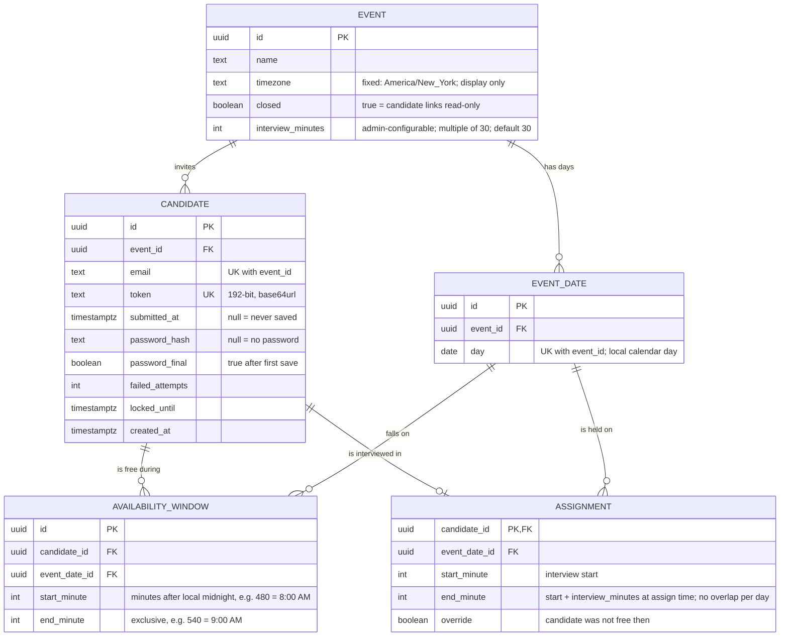

# ERD: data model

Status: **APPROVED by the user**, with interview length made configurable (see below).
**Authoritative** together with [model-tier.md](model-tier.md) and [openapi.yaml](openapi.yaml) (D51). Other docs may lag behind.

## Diagram

## The idea: availability is a list of windows

A window is one free stretch on one day. A candidate has **any number of windows per day**, and every day is independent. Zero windows on a day means not free that day.

Example: free 8-9 AM, 12-2 PM and 7-8 PM on Mon Nov 16 (three rows), and only 10 AM-noon on Tue Nov 17 (one row):

| candidate | day | start_minute | end_minute | meaning |
|-----------|-----|--------------|------------|---------|
| ada | Nov 16 | 480 | 540 | 8:00-9:00 AM |
| ada | Nov 16 | 720 | 840 | 12:00-2:00 PM |
| ada | Nov 16 | 1140 | 1200 | 7:00-8:00 PM |
| ada | Nov 17 | 600 | 720 | 10:00 AM-12:00 PM |

## Table notes

| Table | Notes |
|-------|-------|
| EVENT | One row today (single poll). Kept as a table so candidates and days hang off it cleanly; going multi-event later is then just a UI change. |
| EVENT_DATE | The days the admin selects in the settings UI (max 14). Deleting a day cascades to windows and assignments on it. The admin is warned first. |
| CANDIDATE | Email is the identifier (unique per event). Token is the link credential. The four password columns implement the optional password. |
| AVAILABILITY_WINDOW | The core data. Saving replaces all of a candidate's windows in one transaction. |
| ASSIGNMENT | At most one per candidate. Stores its own start and end, a snapshot of `EVENT.interview_minutes` at assign time. Changing the interview length later does not move existing assignments; only new ones use the new length. |

## Constraints

- `AVAILABILITY_WINDOW`: `480 <= start_minute < end_minute <= 1200`; both are multiples of 30.
- No two windows of the same candidate overlap on the same day. The app sorts and merges overlapping or touching windows before saving, so the table always holds clean ranges.
- `ASSIGNMENT`: `480 <= start_minute < end_minute <= 1200`, both multiples of 30. Double-booking is blocked by an **exclusion constraint**: no two assignments on the same day may have overlapping `[start_minute, end_minute)` ranges. (A plain unique key is no longer enough once interviews can be longer than one slot.)
- `EVENT`: `interview_minutes` is a multiple of 30 between 30 and 180.
- `CANDIDATE`: `UNIQUE (event_id, email)`, `UNIQUE (token)`.
- `EVENT_DATE`: `UNIQUE (event_id, day)`.
- All foreign keys cascade on delete.

## Derived, not stored

- **Status** (invited / submitted / scheduled): from `submitted_at` and whether an ASSIGNMENT exists.
- **Heatmap**: windows expanded into 30-minute slots, counted per (day, slot). Computed on read.
- **"Is this assignment inside the candidate's availability?"**: the slot must sit wholly inside one of that candidate's windows on that day. Otherwise it needs `override = true`.

## Changes from the previous draft (please check these)

1. **Windows instead of one row per 30-minute slot.** This matches how you described availability.
2. **Local day + minutes instead of UTC timestamps.** There is one event timezone, so storing "Nov 16, minute 480" avoids time-zone and daylight-saving bugs and makes the 8 AM-8 PM check trivial. The timezone on EVENT is only for display.
3. **Days are their own table** (EVENT_DATE) rather than an array column, so windows and assignments can point at a real day.
4. **Dropped from CANDIDATE**: nothing. **Added**: `event_id`.

## Resolved questions

1. Window edges are on 30-minute boundaries only. **Yes.**
2. Interview length is **configurable by the admin** (`EVENT.interview_minutes`). The 30-60-90 minute range cap (30 to 180) is my assumption.
3. Dropped by the user.
