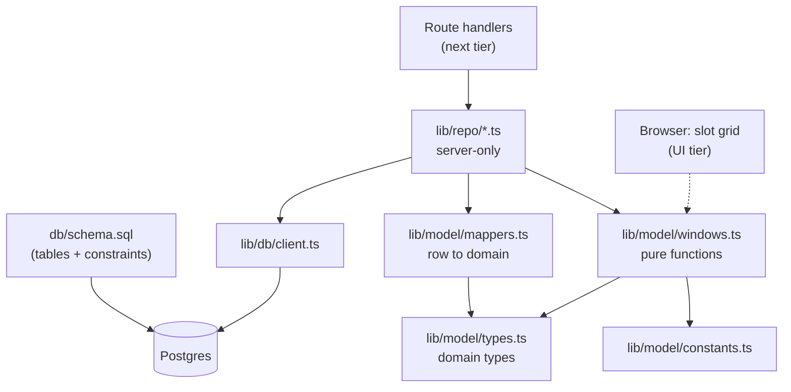

# Model tier: how the tables live in the Next.js app

Status: **Authoritative** together with [erd.md](erd.md) and [openapi.yaml](openapi.yaml) (D51). Decisions: D37-D41 and D50-D54 in [decisions.md](decisions.md).

## 1. Scope

The model tier is everything between Postgres and the route handlers/pages: the SQL schema, the database client, domain types, pure scheduling logic, and repository functions. It has **no HTTP, no cookies, no React**.

Not covered here (later tiers): API routes and validation of request bodies, password hashing and lockout policy (auth module), pages and components.

## 2. Approach

| Choice | Why |
|--------|-----|
| **Plain SQL schema file** is the source of truth for the tables (`db/schema.sql`) | Exclusion constraints and CHECKs live in SQL anyway; only 5 tables. |
| **No ORM** (no Prisma/Drizzle) | Fewer moving parts for a one-hour build; ORMs model exclusion constraints poorly. |
| **`@neondatabase/serverless`** driver | Built for Vercel serverless functions; queries over HTTPS, no connection pool to manage. |
| **Hand-written TypeScript types** + small row-to-domain mappers | Explicit, short, and keeps `snake_case` out of the app. |
| **Database code is server-only** (`import 'server-only'`) | A client component can never accidentally bundle the DB client or `CandidateRecord`. |
| **Pure logic is shared** with the browser | The slot grid and the server use the same window rules. |

## 3. Layers



## 4. Table to app mapping

| Table | Domain type | Repo module | Exposed outside server as |
|-------|-------------|-------------|---------------------------|
| EVENT + EVENT_DATE | `EventConfig` (days folded in as `dates: DayString[]`) | `repo/event.ts` | `EventConfig`; the API builds its wire object from it plus the day constants and drops `id` (D54) |
| CANDIDATE | `CandidateRecord` (server-only, has hash and token internals) | `repo/candidates.ts` | `CandidateSummary` (admin), `CandidateView` (candidate; both built by mappers) |
| AVAILABILITY_WINDOW | `AvailabilityWindow` | `repo/availability.ts` | `AvailabilityWindow[]` as is |
| ASSIGNMENT | `Assignment` | `repo/assignments.ts` | `Assignment` as is |

Rule: **surrogate ids for days (`event_date_id`) never leave the repo.** The app speaks `day: 'YYYY-MM-DD'`; the repo translates by looking up EVENT_DATE.

Naming: the TypeScript types are `EventConfig` and `AvailabilityWindow`, not `Event` and `Window`, because both names already exist as browser globals and would shadow them.

## 5. Domain types (`lib/model/types.ts`)

```ts
export type Id = string;            // uuid
export type DayString = string;     // 'YYYY-MM-DD', local calendar day in the event timezone
export type Minute = number;        // minutes after local midnight; multiple of 30 (480 = 8:00 AM)

export interface EventConfig {
  id: Id;
  name: string;
  timezone: string;                 // fixed 'America/New_York', display only (D48)
  closed: boolean;
  interviewMinutes: number;         // multiple of 30, 30..180
  dates: DayString[];               // sorted ascending
}

export interface AvailabilityWindow {  // one free stretch; end is exclusive
  day: DayString;
  startMinute: Minute;
  endMinute: Minute;
}

export interface Slot { day: DayString; startMinute: Minute }   // one 30-minute cell

export interface Assignment {
  candidateId: Id;
  day: DayString;
  startMinute: Minute;
  endMinute: Minute;                // start + interviewMinutes at assign time
  override: boolean;                // candidate was not free then
}

// SERVER-ONLY: never serialize this directly.
export interface CandidateRecord {
  id: Id;
  eventId: Id;
  email: string;
  token: string;
  submittedAt: Date | null;
  passwordHash: string | null;
  passwordFinal: boolean;
  failedAttempts: number;
  lockedUntil: Date | null;
  createdAt: Date;
}

export type CandidateStatus = 'invited' | 'submitted' | 'scheduled';

// Safe to send to the admin UI: no hash, counters or lock fields.
export interface CandidateSummary {
  id: Id;
  email: string;
  token: string;
  status: CandidateStatus;
  submittedAt: Date | null;
  passwordProtected: boolean;
  assignment: Assignment | null;
}
```

```ts
// What a candidate sees on their own link: never other people's data, never the hash.
export interface CandidateView {
  email: string;
  event: EventConfig;
  windows: AvailabilityWindow[];
  submittedAt: Date | null;
  passwordProtected: boolean;       // a password is required to save
  canSetPassword: boolean;          // !passwordFinal
  lockedUntil: Date | null;
  assignment: Pick<Assignment, 'day' | 'startMinute' | 'endMinute'> | null;
}
```

`toSummary(record, assignment)` and `toCandidateView(record, event, windows, assignment)` in `mappers.ts` are the only ways to get from `CandidateRecord` to something serializable.

## 6. Pure logic (`lib/model/windows.ts`, `constants.ts`)

No database, no `Date` timezone math, trivially unit-testable. Used by the server and by the browser grid.

| Function | Purpose |
|----------|---------|
| `normalizeWindows(ws)` | Sort by day then start; merge overlapping or touching windows. |
| `validateWindows(ws, eventDays)` | Returns a list of issues `{ index, reason }`, where `reason` is `BAD_EDGE` (not on a 30-min edge), `OUT_OF_HOURS` (outside 8 AM-8 PM), `EMPTY_RANGE` (`start >= end`) or `DAY_NOT_IN_EVENT`. |
| `windowsToSlots(ws)` | Expand windows into 30-minute `Slot`s (feeds the heatmap and grid). |
| `slotsToWindows(slots)` | Collapse selected grid cells into windows (grid drag to data). |
| `coversRange(ws, day, start, end)` | True if one window wholly contains the range (checks an assignment fits). |
| `validStarts(ws, day, interviewMinutes)` | Start times where an interview fits inside the candidate's windows (can drive a "fits" highlight). |
| `formatMinute(m)` | `1140` becomes `"7:00 PM"`. |

Constants: `DAY_START_MINUTE = 480`, `DAY_END_MINUTE = 1200`, `SLOT_MINUTES = 30`, `MAX_EVENT_DAYS = 14`, `MIN_INTERVIEW = 30`, `MAX_INTERVIEW = 180`, `MAX_FAILED_ATTEMPTS = 5`, `LOCK_MINUTES = 15`, `MAX_PASSWORD_LENGTH = 128`.

Shared definition (FR-34, D41): a window `[s, e)` covers the 30-minute cells `s, s+30, ..., e-30`. Every place that expands windows (the TypeScript here and the SQL in `getAggregate`) must use it.

Your example, normalized: `[{Nov 16, 480, 540}, {Nov 16, 720, 840}, {Nov 16, 1140, 1200}]`. The slot cells for it are 8:00, 8:30, 12:00, 12:30, 1:00, 1:30, 7:00, 7:30.

## 7. Repository functions (`lib/repo/*.ts`, server-only)

All return domain types, never rows.

**`event.ts`**
- `getEvent(): EventConfig`
- `updateEvent(patch, { confirmDiscard }): EventConfig`: updates name, closed, interviewMinutes and syncs EVENT_DATE rows. The timezone is fixed and not patchable (D48). If removed days have windows or assignments and `confirmDiscard` is false, throws `DatesHaveResponsesError` with the counts.

**`candidates.ts`**
- `listCandidates(): CandidateSummary[]`
- `addCandidates(emails): { created, duplicates, invalid }`: lower-cases and trims, generates tokens.
- `findCandidateByToken(token): CandidateRecord | null`
- `deleteCandidate(id)`, `regenerateToken(id): string`, `resetPassword(id)`
- `registerFailedAttempt(id, { maxFailed, lockMinutes }): { failedAttempts, lockedUntil }`, `clearFailedAttempts(id)`. The repo only persists: it increments the counter and sets `lockedUntil` when the count reaches `maxFailed`. The auth module decides what counts as a failure (a wrong password does, a missing one does not) and passes `MAX_FAILED_ATTEMPTS` and `LOCK_MINUTES` (D52).

**`availability.ts`**
- `getWindows(candidateId): AvailabilityWindow[]`
- `saveAvailability(candidateId, windows, newPasswordHash?): AvailabilityWindow[]`: one atomic batch that replaces all windows, sets `submitted_at`, sets `password_final = true`, stores the hash only if the candidate is not final yet, and resets failed attempts. Returns the normalized windows as saved.
- `getAggregate(): { day, startMinute, candidateIds[] }[]`: windows expanded to slots in SQL (`generate_series(start, end - 30, 30)`), grouped per slot. It must match `windowsToSlots` exactly (shared definition above); a unit test compares the two on the example data.

**`assignments.ts`**
- `getAssignment(candidateId)`
- `assign(candidateId, { day, startMinute, override }): Assignment`: computes `endMinute` from the event's `interviewMinutes`, checks bounds, checks `coversRange` unless `override`, then upserts.
- `unassign(candidateId)`

## 8. Errors (`lib/model/errors.ts`)

The repo throws typed errors, and the API tier maps them to HTTP statuses.

| Error | When | Postgres signal |
|-------|------|-----------------|
| `SlotTakenError(takenByEmail)` | Assignment overlaps another on that day | SQLSTATE `23P01` (exclusion) |
| `NotAvailableError` | Interview range not inside the candidate's windows, no override | app check |
| `InvalidWindowError(reason)` | `assign` got a day not in the event, a start not on a 30-minute edge, or an interview that would end after 8 PM. `reason` is `DAY_NOT_IN_EVENT`, `BAD_EDGE` or `OUT_OF_HOURS` (API code `INVALID_WINDOW`, D50) | app check |
| `WindowsInvalidError(issues)` | `validateWindows` found problems in a saved set (API code `INVALID_WINDOWS`) | app check |
| `DatesHaveResponsesError({ removedDays, affectedWindows, affectedAssignments })` | Removing days with saved data without confirmation | app check |
| `NotFoundError` | Candidate id does not exist | zero rows |
| `PollClosedError` | Save while `closed` | app check |

Duplicate email on add is reported in the result list, not thrown (SQLSTATE `23505` is handled inside `addCandidates`).

## 9. Transactions and concurrency

- **Save availability:** a single non-interactive batch (delete windows, insert windows, update candidate) so it is all-or-nothing. Setting the password uses `WHERE password_final = false`, so a racing second save cannot overwrite an existing hash. Two simultaneous saves: last writer wins, which is fine for one person.
- **Assign:** one upsert keyed on `candidate_id`. The exclusion constraint is what makes concurrent assigns safe, not app-side checking. The coverage check before it can race with a candidate editing at that instant. That is accepted: there is one admin, and `override` exists.
- I'm going from memory on the Neon driver's transaction API. I'll check the exact call against the installed version when I build this.

## 10. Schema (`db/schema.sql`)

```sql
create extension if not exists btree_gist;

create table event (
  id uuid primary key default gen_random_uuid(),
  name text not null,
  timezone text not null default 'America/New_York',
  closed boolean not null default false,
  interview_minutes int not null default 30
    check (interview_minutes between 30 and 180 and interview_minutes % 30 = 0)
);

create table event_date (
  id uuid primary key default gen_random_uuid(),
  event_id uuid not null references event(id) on delete cascade,
  day date not null,
  unique (event_id, day)
);

create table candidate (
  id uuid primary key default gen_random_uuid(),
  event_id uuid not null references event(id) on delete cascade,
  email text not null,
  token text not null unique,
  submitted_at timestamptz,
  password_hash text,
  password_final boolean not null default false,
  failed_attempts int not null default 0,
  locked_until timestamptz,
  created_at timestamptz not null default now(),
  unique (event_id, email)
);

create table availability_window (
  id uuid primary key default gen_random_uuid(),
  candidate_id uuid not null references candidate(id) on delete cascade,
  event_date_id uuid not null references event_date(id) on delete cascade,
  start_minute int not null,
  end_minute int not null,
  check (start_minute >= 480 and end_minute <= 1200 and start_minute < end_minute
         and start_minute % 30 = 0 and end_minute % 30 = 0),
  exclude using gist (candidate_id with =, event_date_id with =,
                      int4range(start_minute, end_minute) with &&)
);

create table assignment (
  candidate_id uuid primary key references candidate(id) on delete cascade,
  event_date_id uuid not null references event_date(id) on delete cascade,
  start_minute int not null,
  end_minute int not null,
  override boolean not null default false,
  check (start_minute >= 480 and end_minute <= 1200 and start_minute < end_minute
         and start_minute % 30 = 0 and end_minute % 30 = 0),
  exclude using gist (event_date_id with =, int4range(start_minute, end_minute) with &&)
);

-- exactly one event row to start with
insert into event (name) select 'Interviews' where not exists (select 1 from event);
```

`scripts/migrate.ts` runs this file. The `if not exists` and the guarded insert make it safe to run twice. Touching windows (8-9 and 9-10) are allowed by the exclusion constraint, and the app merges them anyway.

## 11. File layout

```
db/schema.sql
scripts/migrate.ts
lib/db/client.ts            neon(process.env.DATABASE_URL), server-only
lib/model/constants.ts      shared, client-safe
lib/model/types.ts          shared, client-safe
lib/model/windows.ts        shared, client-safe, pure
lib/model/mappers.ts        server-only
lib/model/errors.ts         server-only
lib/repo/event.ts           server-only
lib/repo/candidates.ts      server-only
lib/repo/availability.ts    server-only
lib/repo/assignments.ts     server-only
lib/model/windows.test.ts   unit tests for the pure logic
```

## 12. Resolved questions

1. No ORM, plain SQL plus typed repo functions: **confirmed** (D40).
2. Interview length range 30-180 minutes: **confirmed** (D37).
3. Exclusion constraints need the `btree_gist` extension. Still unverified on Neon (R9); the fallback in D39 applies if the migration fails.
