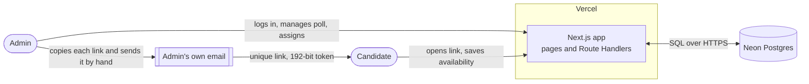
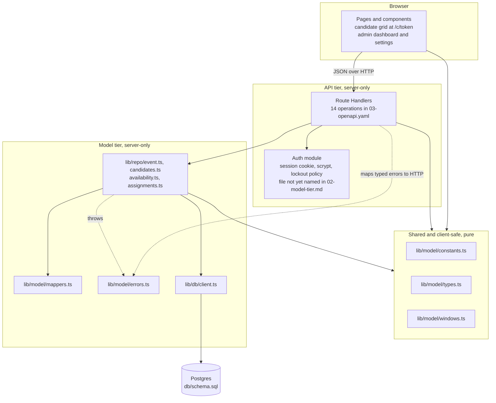
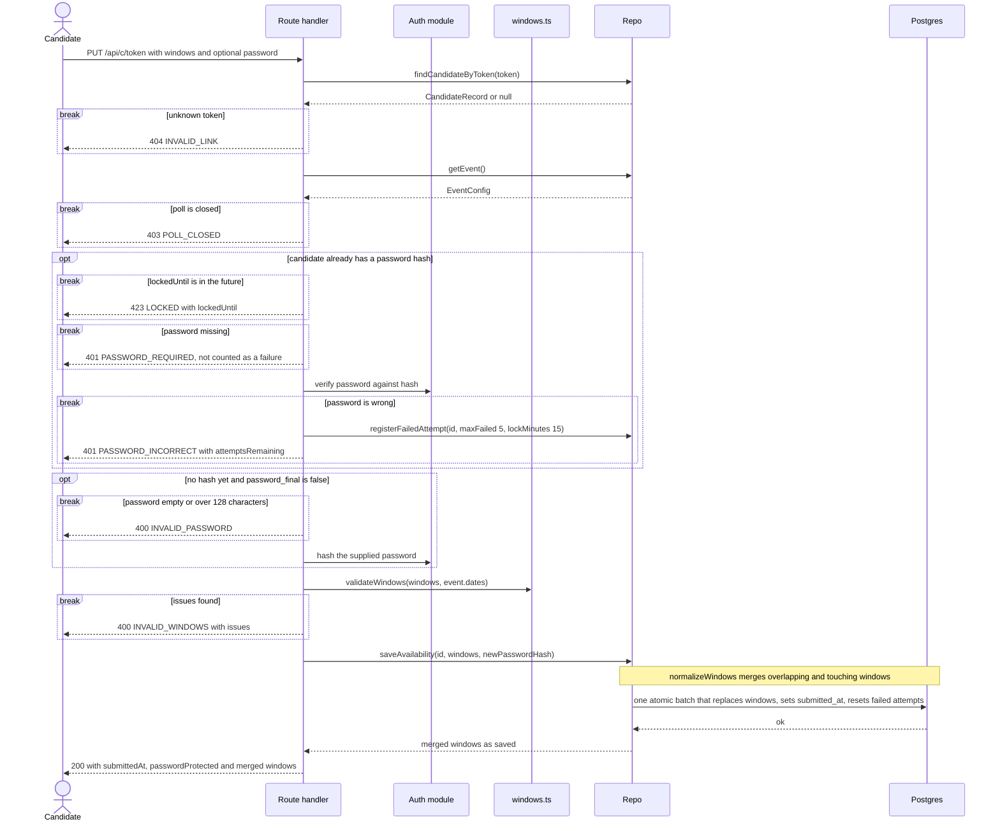
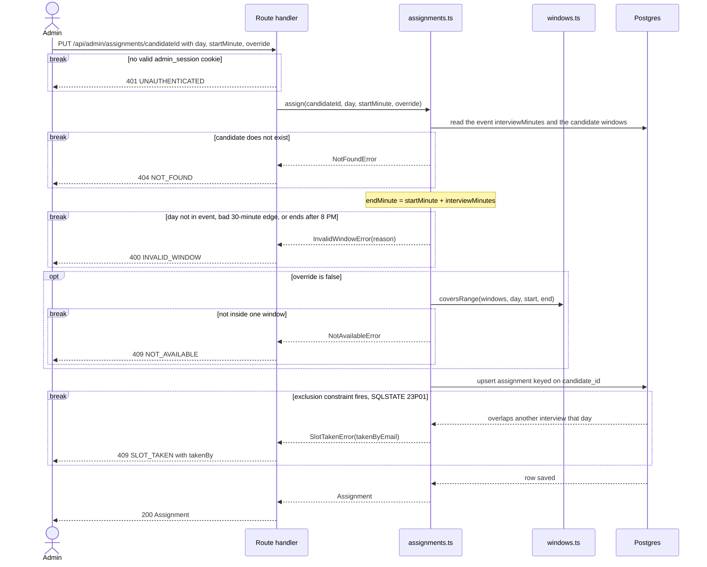
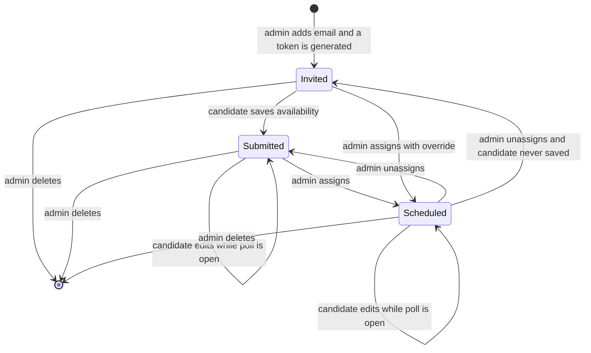
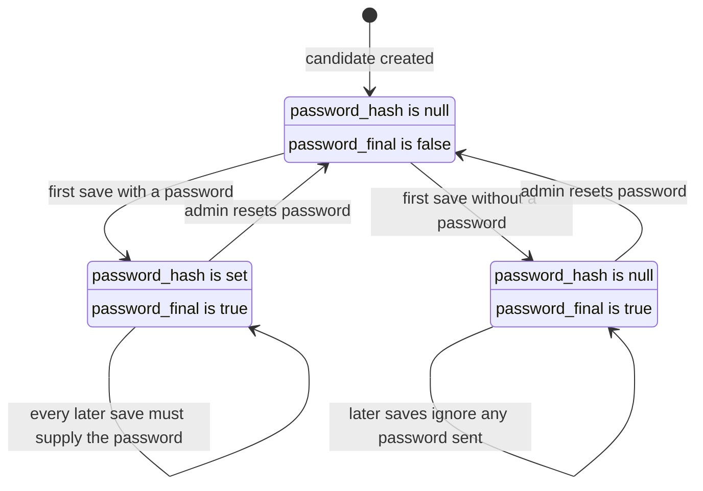

# Architecture: MGMT 330 Interview Scheduler

Status: derived from the authoritative docs ([01-erd.md](01-erd.md), [02-model-tier.md](02-model-tier.md), [03-openapi.yaml](03-openapi.yaml)) and may lag behind them. If they disagree with this file, they win.
Docs index: [README.md](../README.md). Diagrams are Mermaid (GitHub renders them, or use a Mermaid preview extension in VS Code).

## 1. System context

The app never sends email. The admin copies each candidate's link from the dashboard and sends it from their own mail client.
Candidates need no sign-in: the token in the link is the credential. One admin signs in with a shared password from an env var.

## 2. Tiers at a glance

The model tier has no HTTP, cookies or React. Only constants, types and windows.ts are bundled into the browser, so the slot grid and the server share one set of window rules.
Everything else is server-only (`import 'server-only'`), so a client component can never pull in the DB client or `CandidateRecord`.
Route Handlers validate request bodies, call the auth module, map typed errors to status codes, and turn records into wire objects with `toSummary` and `toCandidateView`.

## 3. Routes to model functions

Every admin route first checks the `admin_session` cookie and answers `401 UNAUTHENTICATED` without it, so that check is not repeated below.

| Method and path | operationId | Model-tier functions | Notes |
|-----------------|-------------|----------------------|-------|
| GET `/api/c/{token}` | getCandidateView | `findCandidateByToken`, `getEvent`, `getWindows`, `getAssignment`, `toCandidateView` | No side effects; unknown token is 404 `INVALID_LINK` |
| PUT `/api/c/{token}` | saveAvailability | `findCandidateByToken`, `getEvent`, `validateWindows`, `registerFailedAttempt`, `saveAvailability` | See section 4 |
| POST `/api/admin/login` | adminLogin | none | Auth module compares `ADMIN_PASSWORD`, sets `admin_session` |
| POST `/api/admin/logout` | adminLogout | none | Clears the cookie |
| GET `/api/admin/event` | getEvent | `getEvent` | API adds the day constants and drops `id` (D54) |
| PUT `/api/admin/event` | updateEvent | `updateEvent` | `DatesHaveResponsesError` becomes 409 `DATES_HAVE_RESPONSES` |
| GET `/api/admin/candidates` | listCandidates | `listCandidates` | Returns `CandidateSummary` rows with assignment |
| POST `/api/admin/candidates` | addCandidates | `addCandidates` | Duplicates and invalid emails are reported, not errors |
| DELETE `/api/admin/candidates/{id}` | deleteCandidate | `deleteCandidate` | Cascades windows and assignment |
| POST `/api/admin/candidates/{id}/regenerate-token` | regenerateToken | `regenerateToken` | Old link stops working |
| POST `/api/admin/candidates/{id}/reset-password` | resetCandidatePassword | `resetPassword` | Clears hash, final flag and lockout |
| GET `/api/admin/availability` | getAggregateAvailability | `getAggregate` | Heatmap slots, expanded in SQL |
| PUT `/api/admin/assignments/{candidateId}` | assignInterview | `assign` | See section 5 |
| DELETE `/api/admin/assignments/{candidateId}` | unassignInterview | `unassign` | 204 even if there was none |

## 4. Sequence: candidate saves availability

The checks run in order and each failure stops the request with nothing saved: token, poll open, lockout, password, then window validity.
Only a wrong password counts toward the 5-try lockout (15 minutes, HTTP 423). A missing password does not.
The hash is stored only on the first save (or after an admin reset): the batch writes it with `WHERE password_final = false`, so a racing second save cannot overwrite it. If the candidate is final with no password, a supplied password is ignored.

## 5. Sequence: admin assigns an interview

The client sends only a start time. The server computes the end from the event's interview length and stores both on the assignment.
The coverage check is a friendly pre-check. The exclusion constraint is what guarantees no double-booking, even for concurrent requests.

## 6. State: candidate lifecycle

Status is never stored. It is derived: scheduled if an assignment exists, else submitted if `submitted_at` is set, else invited.
Closing the poll makes candidate links read-only, so the edit loops only apply while it is open.

## 7. State: candidate password

Candidates can never change or remove a password. Only the admin reset returns a candidate to Open, and it keeps their windows and assignment.
A reset also clears `failed_attempts` and `locked_until`. Viewing the link never needs the password; only saving does.

## 8. Data model

The data model lives in [01-erd.md](01-erd.md) (EVENT, EVENT_DATE, CANDIDATE, AVAILABILITY_WINDOW, ASSIGNMENT); it is deliberately not redrawn here.

## 9. Key decisions

Full log with status and cost-if-wrong: [04-decisions.md](04-decisions.md).

| Decision | Choice | Reason |
|----------|--------|--------|
| Availability storage (D33, D35) | Windows: candidate, day, start, end, many per day; merged on save | Matches how candidates describe free time; heatmap slots are derived. |
| Time representation (D34, D5, D48) | Local day plus minutes after midnight, fixed America/New_York | One timezone, so no UTC or daylight-saving bugs; the 8 AM-8 PM check is trivial. |
| Interview length (D37, D38) | Admin-configurable, 30-180 minutes; each assignment stores its own start and end | Changing the length later never moves existing interviews. |
| Double-booking guard (D39) | Postgres exclusion constraint (`btree_gist`), SQLSTATE 23P01 | A unique key cannot catch overlapping ranges; safe under concurrency. Unverified on Neon (R9). |
| Persistence and access (D8, D40) | Neon Postgres, plain SQL schema, typed repo functions, no ORM | Vercel's disk is ephemeral; ORMs handle exclusion constraints poorly. |
| Shared vs server-only code (D41) | Pure window logic shared with the browser; DB code server-only | The grid and the server use one definition of a window and its slots. |
| Candidate identity (D11, D12, D13) | 192-bit URL token, no sign-in; GET never changes data | Matches "no sign-in"; email scanners prefetch links. |
| Candidate password (D21-D26, D28, D52) | Optional, first save only, immutable, admin reset; 5 wrong tries lock for 15 minutes (423), missing does not count | Stops forwarded links from editing; stateless, sent with each save (D29). |
| Admin auth (D9, D47) | One shared env-var password, signed cookie, no login rate limit | One admin; relies on a long random `ADMIN_PASSWORD`. |
| Scope cuts (D2, D31) | No email sending, no export | Admin copies links by hand; the schedule is view-only. |
